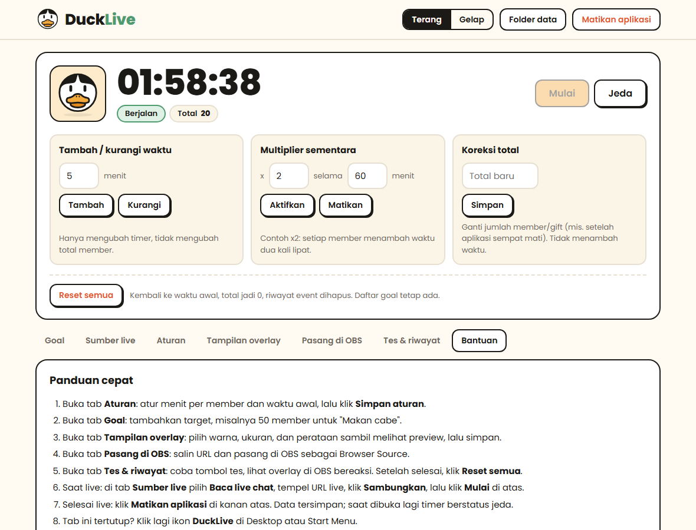
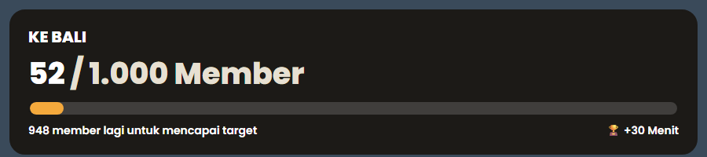
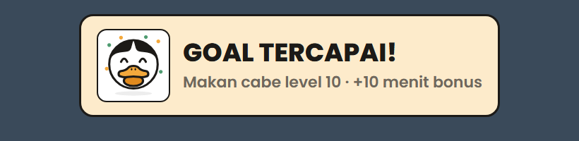
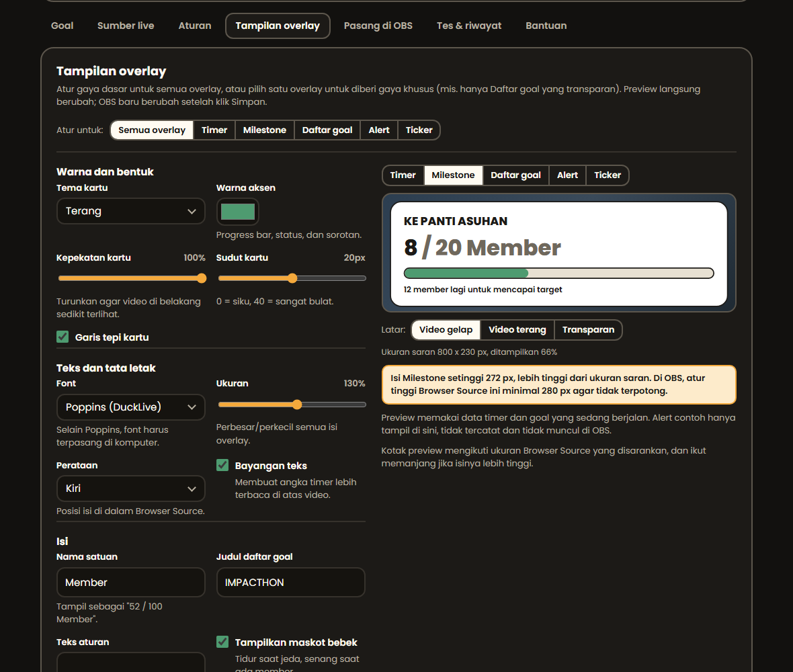

# DuckLive

Timer dan milestone **subathon** untuk live YouTube, dengan overlay siap pakai untuk OBS. Berjalan 100% di komputermu: tidak ada server, akun, atau langganan.

Setiap member baru, gift membership, dan (opsional) Super Chat menambah waktu timer dan memajukan goal. Maskot bebek di overlay ikut bereaksi: tidur saat timer jeda, senang saat ada member baru, merayakan saat goal tercapai.



| Timer | Milestone | Alert |
|---|---|---|
|  |  |  |

## Fitur

- **6 overlay OBS**: timer, milestone (goal berikutnya + progress bar), daftar goal, alert (dengan suara), ticker member terbaru / top gifter, dan live chat (Super Chat dan member disorot, pesan yang dihapus moderator ikut hilang).
- **Membaca live chat otomatis**: tanpa API key (tempel URL live), atau lewat YouTube Data API resmi. Menyambung ulang sendiri jika internet putus.
- **Goal** dengan bonus waktu, centang otomatis, dan **ganti scene OBS** otomatis saat goal tercapai.
- **Tampilan overlay** bisa diatur dengan preview langsung: tema, warna, kepekatan, sudut, font, ukuran, perataan. Bisa sama untuk semua overlay atau berbeda per overlay.
- Kontrol manual: mulai/jeda, tambah/kurangi waktu, multiplier sementara (mis. x2 selama 60 menit), koreksi total, undo per event.
- Halaman Admin mode terang dan gelap, ekspor riwayat ke CSV, dan installer Windows tanpa hak Administrator.



## Cara pasang (Windows)

1. Buka halaman **Releases**, unduh `DuckLive-Setup-x.y.z.exe`, lalu klik dua kali.
   - Jika muncul **"Windows protected your PC"**: klik **More info**, lalu **Run anyway**. Peringatan ini muncul karena aplikasi gratis ini tidak memakai sertifikat berbayar; cocokkan kode di `SHA256SUMS.txt` untuk memastikan file asli.
   - Tidak perlu hak Administrator.
2. Halaman **Admin** terbuka di browser. Ikuti tab **Bantuan** di sana.
3. Lain kali cukup klik ikon **DuckLive** di Desktop atau Start Menu. Jika aplikasi sudah berjalan, ikon itu hanya membuka Admin lagi.
4. Untuk menutup aplikasi: tombol **Matikan aplikasi** di kanan atas Admin.

Tanpa installer: unduh `DuckLive-Portable-x.y.z.zip`, ekstrak, jalankan `DuckLive.exe`.

### Overlay untuk OBS

Di OBS: **Sources**, klik **+**, pilih **Browser**, tempel URL. Latar overlay otomatis transparan. Tombol salin tersedia di tab **Pasang di OBS**.

| URL | Isi | Ukuran saran |
|---|---|---|
| `http://127.0.0.1:8765/overlay/timer` | Timer dan maskot | 800 x 200 |
| `http://127.0.0.1:8765/overlay/milestone` | Goal yang sedang dikejar + progress bar | 800 x 230 |
| `http://127.0.0.1:8765/overlay/goals` | Daftar semua goal | 600 x 700 |
| `http://127.0.0.1:8765/overlay/alerts` | Notifikasi member, gift, goal (dengan suara) | 800 x 250 |
| `http://127.0.0.1:8765/overlay/ticker` | Member terbaru dan top gifter | 1920 x 80 |
| `http://127.0.0.1:8765/overlay/chat` | Live chat penonton (paling cocok dengan sumber tanpa API key) | 450 x 600 |

### Jika ada masalah

- **"Port 8765 sedang dipakai aplikasi lain"**: tutup aplikasi tersebut atau restart komputer.
- **Admin meminta token**: tutup tab, lalu klik ikon DuckLive (token dikirim otomatis).
- **Overlay di OBS tidak berubah setelah update**: di OBS, Properties pada Browser Source, klik **Refresh cache of current page**.
- **Catatan error** ada di `log.txt` di folder data (`%APPDATA%\DuckLive`, tombol **Folder data** di Admin).

## Aturan hitung

- Member baru = 1. **Gift x N = N**. Hanya event pembelian gift yang dihitung; event "penerima gift" diabaikan agar tidak dobel.
- Waktu yang ditambah = jumlah x menit per member/gift x multiplier aktif. Super Chat opsional (mis. setiap Rp10.000 = 1 menit, hanya mata uang yang sama).
- Hadiah Jewels YouTube (Gold coin, Star, dll.) tidak dihitung.
- Timer dibatasi **batas maksimum** (default 100 jam). Setelah timer **selesai**, event tetap dihitung ke goal tetapi tidak menambah waktu.
- Goal tercentang otomatis saat total mencapai target. **Bonus waktu** goal hanya diberikan sekali.
- **Undo** membatalkan hitungan dan waktu dari satu event (bonus goal yang sudah diberikan tidak ditarik).
- State tersimpan otomatis. Setelah aplikasi dibuka ulang, timer berstatus **Jeda** dan sumber live perlu disambungkan lagi.

## Sumber live

| Sumber | Setup | Catatan |
|---|---|---|
| **Baca live chat** | Tempel URL live | Tanpa API dan kuota. **Tidak resmi**: membaca halaman live chat publik YouTube, bisa berhenti bekerja jika YouTube berubah, dan secara teknis bertentangan dengan Ketentuan Layanan YouTube. Uji dulu di live kecil. |
| **YouTube API** | OAuth (lihat di bawah) | Resmi dan stabil. Kuota default 10.000 unit/hari, tiap pengecekan chat = 5 unit; default dicek tiap 45 detik agar cukup 24 jam. Hanya pemilik channel yang bisa membaca event membership. |

Kedua sumber menyambung ulang otomatis jika koneksi putus (jeda 5 sampai 60 detik), dan berhenti dengan pesan jelas jika masalahnya tidak bisa pulih sendiri (URL salah, belum login, kuota habis, live selesai).

**Setup YouTube API**: di Google Cloud aktifkan *YouTube Data API v3*, buat OAuth client tipe **Desktop**, unduh JSON-nya dan simpan sebagai `client_secret.json` di folder data, lalu klik **Login Google** di Admin. Scope yang diminta hanya `youtube.readonly`. Setiap pengguna memakai kredensial Google Cloud-nya sendiri; jangan pernah menyertakan `client_secret.json` milikmu di rilis.

### Ganti scene OBS

Di OBS buka **Tools**, **WebSocket Server Settings**, centang **Enable WebSocket server**, lalu klik **Show Connect Info**. Di Admin, buka tab **Aturan**, bagian **Integrasi OBS**: isi port dan password, lalu klik **Simpan & tes koneksi**. Setelah tersambung, kolom Scene OBS di tab Goal berisi daftar scene dari OBS, dan tombol **Coba** memindahkan scene saat itu juga.

## Keamanan

- Server hanya mendengarkan `127.0.0.1` dan hanya menerima Host `127.0.0.1`/`localhost` (menangkal DNS rebinding), kecuali mode LAN.
- Semua aksi yang mengubah data butuh token admin (disimpan di folder data). Overlay hanya membaca. WebSocket menolak koneksi dari halaman situs lain.
- **Mode LAN** (kontrol dari HP): jalankan dengan `DUCKLIVE_LAN=1`, buka `http://IP-PC:8765/admin`, masukkan token. Pakai hanya di jaringan tepercaya; koneksinya HTTP biasa tanpa enkripsi.
- Teks dari chat selalu ditampilkan sebagai teks biasa (tanpa `innerHTML`), dan ekspor CSV menetralkan formula spreadsheet.
- Password OBS disimpan apa adanya di database lokal.

## Pengembangan

Butuh Python 3.10+.

```bash
python -m venv .venv
.venv\Scripts\activate          # Linux/macOS: source .venv/bin/activate
pip install -r requirements-dev.txt
python run.py                   # http://127.0.0.1:8765/admin
python -m pytest -q
```

Variabel lingkungan:

| Variabel | Fungsi |
|---|---|
| `DUCKLIVE_PORT` | Port server (default `8765`) |
| `DUCKLIVE_DATA` | Folder data (default `%APPDATA%\DuckLive` atau `~/.local/share/ducklive`) |
| `DUCKLIVE_TOKEN` | Token admin tetap, alih-alih dibuat acak |
| `DUCKLIVE_LAN=1` | Dengarkan di semua antarmuka jaringan |
| `DUCKLIVE_NO_BROWSER=1` | Jangan buka browser saat start |

### Struktur

```
app/
  engine.py        Logika timer, goal, event, undo, pengaturan (tanpa I/O jaringan)
  main.py          Server FastAPI: halaman, REST API, WebSocket, start aplikasi
  db.py            SQLite
  obs.py           Klien OBS WebSocket (protokol v5) untuk ganti scene
  paths.py         Lokasi folder data dan file web
  sources/         Sumber event: base (auto-reconnect), scrape + ytchat (live chat), api (YouTube API)
web/
  admin.html       Halaman Admin
  overlay_*.html   Overlay OBS
  static/          CSS/JS bersama, font Poppins, logo dan maskot
docs/              Landing page statis (GitHub Pages) dan screenshot README
tests/             pytest
tools/build.py     Build PyInstaller + installer Inno Setup + zip portable
installer/         Skrip Inno Setup
```

### Gaya kode

- Python: `ruff check .` dan `ruff format .` (konfigurasi di `pyproject.toml`).
- HTML/JS/CSS: `npx prettier@3 --write "web/**/*.{html,js,css}"` (konfigurasi di `.prettierrc.json`).
- Tanpa framework atau langkah build untuk web: HTML, CSS, dan JavaScript biasa.

CI menjalankan lint, cek format, dan tes di setiap push dan pull request.

## Status pengujian

- **Otomatis (pytest)**: engine, API, autentikasi, cek host/origin, WebSocket, validasi input, parser chat, auto-reconnect sumber, klien OBS WebSocket (dengan server OBS tiruan), migrasi folder data.
- **Manual**: build PyInstaller; Admin dan overlay di Chromium; membaca live chat dari live YouTube sungguhan; koneksi dan daftar scene dari OBS 33 asli.
- **Belum diuji**: kompilasi installer Inno Setup (dibuat di CI), event membership asli lewat pembaca live chat, login Google untuk mode API, pindah scene di OBS asli dengan klien OBS bawaan (sudah diuji dengan server OBS tiruan).

## Kredit dan lisensi

Kode DuckLive dirilis dengan [lisensi MIT](LICENSE).

- Font [Poppins](https://github.com/itfoundry/Poppins) oleh The Poppins Project Authors, lisensi [SIL Open Font License 1.1](web/static/fonts/OFL.txt).
- [chat-downloader](https://github.com/xenova/chat-downloader) (MIT) untuk membaca pesan live chat.
- [websockets](https://github.com/python-websockets/websockets) (BSD-3-Clause) untuk koneksi ke OBS WebSocket.

DuckLive tidak berafiliasi dengan, atau didukung oleh, YouTube, Google, maupun OBS Project.
